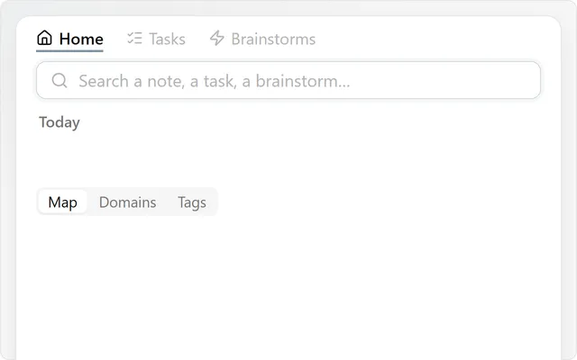

[Snailkit](../README.md) · **Home**

# Home

The front page of your vault. It fills itself in from your notes: nothing to set up, nothing to
maintain.

## What you find there

- **Search**, the cursor already in it.
- **New brainstorm**, **New task** and **New note**, side by side.
- **Today**: today's note, the tasks due, the brainstorms waiting.
- **Your pins**, the notes you come back to.
- **A map of your notes**, drawn from the links between them. Drag a note onto another to place
  it under it.
- **Recent**: what you opened lately.

## The idea

Give each note a parent, with an `up: "[[Projects]]"` property or a link on its first line. Home
draws your vault from there: your main notes become **domains**, each with its notes and its open
tasks. No folders to maintain.

## New note

A small window: the name, and where the note goes, chosen on the map (hover to unfold, click to
choose). The note gets its `up` property toward that parent and sits next to it.

- The name is checked as you type: characters a file or a link cannot hold are shown at once, and
  when a note of that name already exists, **Create** becomes **Open it**.
- The parent proposed: from a note, that note when it has notes under it, else its parent; from
  Home, the last parent you chose. **New note here** on the map opens it on that note.
- Text selected in a note becomes the name, then a link to the new note.
- **Enter** creates, **Ctrl+Enter** creates and opens in a new tab.
- **More options**, folded away and remembered: a link to the new note at the end of the parent,
  a template (from the core Templates or Templater folder), and whether to open the note or stay
  where you are.
- Settings › Home › **Open it with Ctrl+N**: Obsidian's "Create new note" opens this window
  instead of an empty Untitled note. Your hotkeys are not changed; turn it off and Ctrl+N works as
  before. A **New note** command is there too, to give it any key.

## Good to know

- Home is the first tab of the [Workbench](workbench.md). It can open by itself when Obsidian starts and in every new tab.
- The **Map**, **Domains** and **Tags** views show the same vault three ways.
