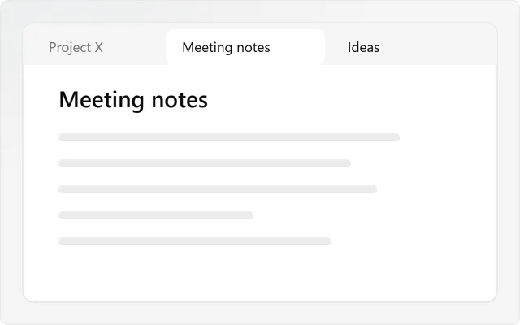

[Snailkit](../README.md) · **Mouse gestures**

# Mouse gestures

Close a tab the way you do in your web browser: hold the right mouse button, draw a short line, release. Draw down to open the launcher; other lines open Home, Tasks, Brainstorms or a new note.

## Try it

1. Over a note, hold the right mouse button.
2. Draw down, then right, and release. The tab closes.
3. Draw left, then up, to bring it back.

| Gesture | Action |
| --- | --- |
| ↓ → | Close tab |
| ← ↑ | Reopen closed tab |
| ← | Go back |
| → | Go forward |
| ↓ ↑ | New tab |
| ↑ → | Next tab |
| ↑ ← | Previous tab |
| ↓ | Launcher |
| ↑ | Open Home |
| → ↓ | Open Tasks |
| ← ↓ | Open Brainstorms |
| ↓ ← | New note |

Change them, or turn one off, in **Settings → Snailkit → Mouse gestures**. Under **Your gestures**, **Add a gesture** gives a gesture to any command of Obsidian or of a plugin.

## Good to know

- A plain right-click still opens the menu. A gesture starts once the line is about 25 px long.
- While you draw, the line and the name of the action follow the pointer. Turn off **Show the line** to hide them.
- A gesture acts on the tab under the pointer, or on the tab of the open note when you draw over a side panel.
- Home, Tasks and Brainstorms come up in the Workbench you already have open; a new one opens only when there is none. New note opens the New note window, with the note you drew on as its starting point. These need their tool turned on.
- The **launcher** pops out where your line ended: type to open a note (or to name a new one, Enter opens the New note window), or pick one of the tabs open now or a brainstorm in progress. Its buttons start a brainstorm, a task or a note, or bring up Home, Tasks or Brainstorms. `↑` `↓` to move, Enter to open, `Ctrl`/`Cmd`+Enter in a new tab. It is also the command **Open the launcher**, to give it a hotkey.
- A gesture of your own runs its command on the tab you draw on, as its hotkey would. A new one gets a gesture nobody uses yet; pick another in its menu. If its plugin is turned off, the line says so and nothing runs.
- Press Escape or another mouse button before releasing to cancel.
- On macOS and Linux, the right-click menu opens when you release the button, not when you press it, and spelling suggestions may be missing from it.
- Gestures need a mouse: they do nothing on a phone or a tablet.
