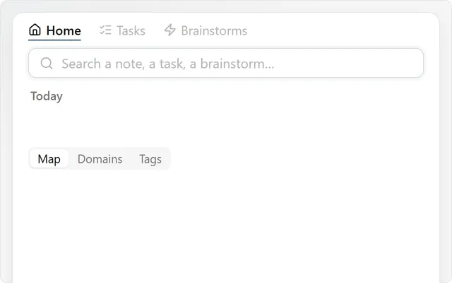

[Snailkit](../README.md) · **Workbench**

# Workbench

Keep Home, Tasks and Brainstorms together in one panel, each in its own tab.

## Try it

1. Click the Tasks ribbon icon or run **Snailkit: Open the workbench as a page**.
2. Click a tab, or use `Alt+1` through `Alt+9` to switch tabs.

## Good to know

- Keyboard: `Alt+1` `Alt+2` `Alt+3` or `Alt+←` `Alt+→` switch tabs, `Tab` jumps from one zone of the page to the next, `↑` `↓` move inside it, `?` shows every key.
- From anywhere in Obsidian: give the commands **Workbench: Home**, **Tasks** and **Brainstorms** a hotkey in **Settings → Hotkeys**.

- Turn on a tool to see its tab.
- Use the Workbench as a page or in the side panel.
- It can open at startup and in new tabs: choose when in **Settings → Snailkit → Workbench settings**.
- Choose its starting tab separately for computer and phone in the same settings. The defaults are Automatic on computer and Tasks on phone. Automatic uses Home when enabled, otherwise the first tool; unavailable choices use Automatic.
- **Text size**, in the same settings: Automatic follows the text of your notes (Appearance › Font size), or pick a size; the whole Workbench grows or shrinks with it.
- Right-click a tab: **Open the Workbench on this tab** (on this device, computer or phone) and **Show the count** (hide the number next to Tasks or Brainstorms).
